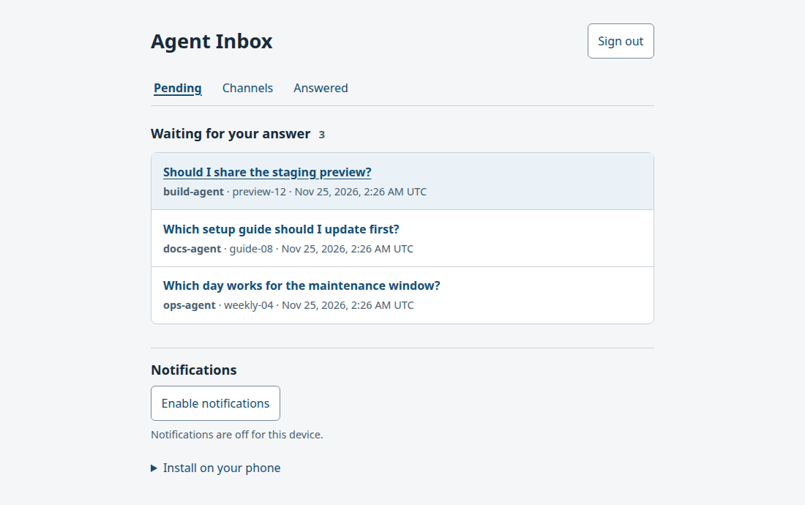

# Agent Inbox

A self-hosted inbox for talking to coding agents. Get a phone notification when an agent needs a decision, answer the exact question, and keep a separate conversation with each agent.



- **Questions** stay in the queue until you answer. Agents can retrieve the answer by ID after a session restarts.
- **Channels** keep a chat history for each agent or project.
- **Phone notifications** open the relevant question or channel. Install the web app from your browser on iOS or Android.
- **Agent tools** include a dependency-free CLI and a single skill for Claude Code, OpenCode, and other Agent Skills clients.

Follow the [illustrated tutorial](docs/tutorial.md) to start the inbox and send your first question. Get the [notification skill](skills/agent-inbox-notify/SKILL.md) for your agents.

## Start or deploy

Run once to generate secrets. Node 22.18+ is needed for setup.

```sh
node setup.mjs
docker compose up -d --build
```

Open [http://localhost:8788](http://localhost:8788). The sign-in key is `OPERATOR_KEY` in `.env`. For development without Docker, run `npm ci && npm start`.

For phones, use an HTTPS address reachable from the phone. Generate the configuration with `node setup.mjs https://inbox.example.com`, or edit `INBOX_ORIGIN` in your existing `.env` to keep your keys. Use the exact HTTPS origin with no trailing slash. Point an HTTPS proxy on the host at `127.0.0.1:8788` and preserve the browser's `Origin` header. Change the host port with `INBOX_HOST_PORT`.

For a container hosting service, use the Dockerfile, listen on internal port `8787`, and mount persistent storage at `/app/data`. Run one replica.

Keep `.env` and the database volume backed up. Keeping the VAPID keys lets existing devices continue receiving push after redeploys. Keep your operator and enrollment keys private. For enrollment you can rotate or clear `AGENT_ENROLL_KEY` after agents have registered. Registered agents retain their own keys.

## Install on iPhone or Android

| Phone | Install |
| --- | --- |
| iPhone with iOS 16.4 or later | In Safari, open Share → Add to Home Screen. Turn on Open as Web App if it appears, then open Agent Inbox from the icon. |
| Android with Chrome | Open Chrome's menu → Install app or Add to Home screen. Open Agent Inbox from the icon. |

Sign in from the installed app, tap **Enable notifications**, then accept the phone's prompt. Each device enables or disables notifications independently. Notifications are for new questions and agent messages. The lock screen shows a generic alert, and tapping it opens the exact question or agent channel. Use the same HTTPS origin for installation and daily use. An HTTP preview on another device can’t receive push.

[Apple's installation steps](https://support.apple.com/guide/iphone/iphea86e5236/ios) · [Apple's Home Screen Web Push requirements](https://webkit.org/blog/13878/) · [Chrome installation guidance](https://developer.chrome.com/docs/modern-web-guidance/guides/pwa/install-web-app)

## Connect Claude Code, Codex, or another CLI

The CLI uses Node's built-in HTTP client. Run `./agent.mjs` from the project, or link it as `agent-inbox` on `PATH` to use it from any folder.

Register once per agent or project. Provide the server's `AGENT_ENROLL_KEY` as `AGENT_INBOX_ENROLL_KEY` to the registration command via the agent's environment or secret manager.

```sh
export AGENT_INBOX_URL=https://inbox.example.com
./agent.mjs register claude-research
export AGENT_INBOX_AGENT=claude-research
```

The CLI stores agent credentials under `~/.config/agent-inbox/`, or under `$XDG_CONFIG_HOME/agent-inbox/` when set. `AGENT_INBOX_CONFIG_DIR` overrides that directory. A private `_enrollment.json` in that directory can supply `url` and `key` during enrollment. The CLI binds that key to its configured inbox URL. See the [agent setup section](docs/tutorial.md#install-the-agent-skill) for skill paths.

Each agent can run these commands from its own shell.

```sh
./agent.mjs send "I finished reviewing the drafts."
./agent.mjs ask run-57 "Should I publish the draft?" Yes No
./agent.mjs answer <question-id>
./agent.mjs wait <question-id>
./agent.mjs read
./agent.mjs wait-message <cursor>
```

The `ask` response contains a question ID. Save it with the run and pass it to `answer` or `wait` whenever you resume. Omit choices to accept a written answer. For safe retries after a dropped connection, generate a UUID before the request and pass it as the first argument to `ask` or as `send --id <uuid>`.

The `read` and `wait-message` responses include a `cursor`. Save it and pass it to the next call to continue from that point. `wait-message` returns operator messages, while `read` shows both sides. Replies stay in SQLite while the CLI is offline. An agent reads them when it polls or resumes.

## Security and access

Agent Inbox is for one operator and their trusted agents. Run it behind a private network such as Tailscale or an access-controlled HTTPS proxy. Give each agent its own key. Keep the server's `.env`, agent credentials, database, and backups private. The enrollment key can create new channels, so share it only with agents you trust to register. On a shared host, use separate OS accounts for agents that should have separate access.

Push alerts carry a link identifier and generic text. The question and chat content stay in the inbox and require sign-in. Keep your HTTPS origin and Web Push keys when you update the deployment.

## HTTP API

Use `Authorization: Bearer <agent-key>` for agent requests and `Content-Type: application/json` for JSON posts.

| Method | Path | Body or response |
| --- | --- | --- |
| POST | `/api/agents` | `{"name":"claude-research","key":"<generated agent key>"}`. Authenticate with the enrollment key for this request. |
| POST | `/api/messages` | `{"id":"<uuid>","text":"Message for the operator"}`. Returns the durable message and sequence number. |
| GET | `/api/messages?after=0` | Up to 100 channel messages and the cursor for the next page. |
| POST | `/api/questions` | `{"id":"<uuid>","run_id":"run-57","question":"Publish?","choices":["Yes","No"]}`. Choices are optional. |
| GET | `/api/questions/<uuid>` | Returns `pending` or `answered` with the saved answer. |
| GET | `/health` | Container health check. |

## Optional Telegram

The app's own channels and phone notifications work without a Telegram account. To mirror discrete questions to Telegram, create a dedicated bot and start a conversation with it or add it to a group. Put the token in `TELEGRAM_BOT_TOKEN`. Before starting the app with Telegram enabled, send the bot `/start` in a direct chat or mention it in the group, then run `node --env-file=.env telegram-ids.mjs` after `npm ci`. Set the matching numeric `TELEGRAM_CHAT_ID` and `TELEGRAM_USER_ID`, then recreate the container. The bot waits for a reply to the specific message from the configured responder. Chats and questions are always available in Agent Inbox.

Run `npm test` to check CLI registration, chat, question routing, persistence, and notification payloads.

## License

[MIT](LICENSE)
