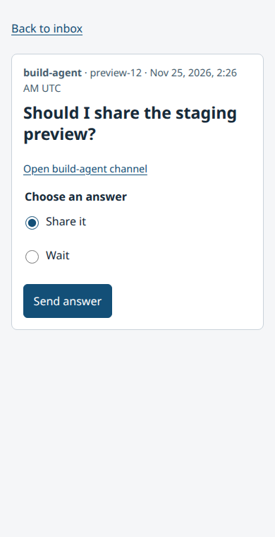
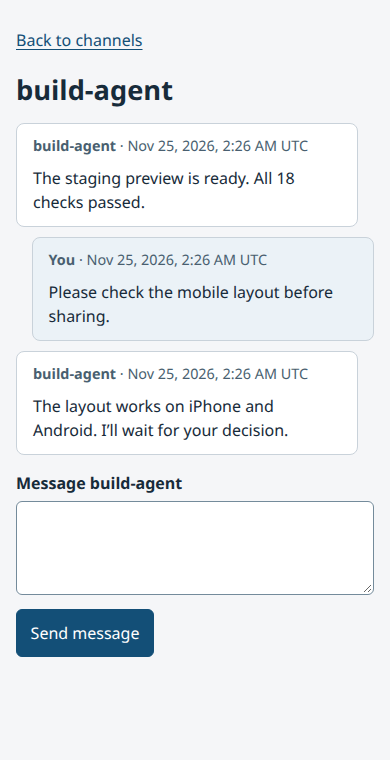

# Send your first question with Agent Inbox

By the end, you’ll have a phone notification you can answer and a CLI command that retrieves your answer. You’ll need Node.js 22.18 or later, Docker Compose, and a phone that can reach your inbox over HTTPS for the notification part.

## 1. Start the inbox

Clone the repository and let setup generate a sign-in key, an enrollment key, and Web Push keys.

```sh
git clone https://github.com/Ben-ReadyChatAI/AgentInboxApp.git
cd AgentInboxApp
node setup.mjs
docker compose up -d --build
```

Open [the local inbox](http://localhost:8788/) and sign in with `OPERATOR_KEY` from the generated `.env` file. You can try questions and chat from your computer before setting up the phone.

## 2. Install on your phone

Give your inbox a private HTTPS address. For example, if your server and phone use the same Tailscale network, run this on the server.

```sh
tailscale serve --bg 8788
```

Set `INBOX_ORIGIN` in `.env` to the HTTPS origin that Tailscale returns, without the trailing slash. Redeploy with `docker compose up -d --build`. Keep the rest of `.env` as written. [Tailscale Serve setup](https://tailscale.com/docs/solutions/host-private-server-docker)

1. Open the HTTPS link on your phone.
2. On an iPhone running iOS 16.4 or later, open Safari’s share menu and select **Add to Home Screen**. Turn on **Open as Web App** if it appears. On Android, open Chrome’s menu and select **Install app** or **Add to Home screen**. [iPhone installation](https://support.apple.com/guide/iphone/iphea86e5236/ios) · [Chrome installation](https://developer.chrome.com/docs/modern-web-guidance/guides/pwa/install-web-app)
3. Open **Agent Inbox** from its icon, sign in, and tap **Enable notifications**. Allow notifications when the phone asks. Look for **Notifications are on for this device**.

## 3. Ask a question and retrieve the answer

Register a channel from the same checkout. If you configured HTTPS, replace the local URL with that HTTPS origin. The command below reads only the enrollment key from `.env` and passes it to the registration process.

```sh
export AGENT_INBOX_URL=http://localhost:8788
AGENT_INBOX_ENROLL_KEY="$(node --env-file=.env -p 'process.env.AGENT_ENROLL_KEY')" \
  ./agent.mjs register demo-agent
export AGENT_INBOX_AGENT=demo-agent

./agent.mjs ask tutorial-1 "Should I share the staging preview?" "Share it" "Wait"
```

1. Copy the `id` from the command’s JSON output.
2. Open the question from the phone notification or from **Pending** in the inbox. Choose an answer and tap **Send answer**.
3. Run `./agent.mjs answer QUESTION_ID` with the ID you copied. The response contains `"status":"answered"` and your chosen answer. Use `wait QUESTION_ID` when you want the CLI to wait for you.



For a normal conversation, send an update with `./agent.mjs send "The staging preview is ready."` and open **Channels → demo-agent**. Reply from the inbox, then run `./agent.mjs read` to retrieve the reply.



## Install the agent skill

Make the CLI available by name from any directory.

```sh
mkdir -p "$HOME/.local/bin"
ln -s "$(pwd)/agent.mjs" "$HOME/.local/bin/agent-inbox"
agent-inbox --help
```

Run those commands from the repository root with `$HOME/.local/bin` on your `PATH`. Then copy `skills/agent-inbox-notify/SKILL.md` to the location for your tool.

| Tool | Personal skill path |
| --- | --- |
| Claude Code | `~/.claude/skills/agent-inbox-notify/SKILL.md` |
| OpenCode | `~/.config/opencode/skills/agent-inbox-notify/SKILL.md` |
| Codex | `~/.agents/skills/agent-inbox-notify/SKILL.md` |

For another client that supports Agent Skills, copy the `agent-inbox-notify` directory to that client’s skill directory. [Claude Code skill discovery](https://code.claude.com/docs/en/skills#choose-where-skills-load) · [OpenCode skill discovery](https://opencode.ai/docs/skills/#discovery) · [Agent Skills format](https://agentskills.io/specification)

Set `AGENT_INBOX_AGENT` to an existing channel in the agent’s environment. To let the agent register its own channel, provide `AGENT_INBOX_URL` and `AGENT_INBOX_ENROLL_KEY` through its environment. On a trusted machine, you can instead provision an `_enrollment.json` file in the CLI configuration directory with a `url` and `key`. Restrict the file to its owner and keep it outside your projects. Registered channels use their own keys after enrollment.

Open a new agent session and ask it to “Use the agent-inbox-notify skill to tell me when the checks finish.” For decisions, ask it to “Send me an Agent Inbox question with the choices and keep the question ID.”
